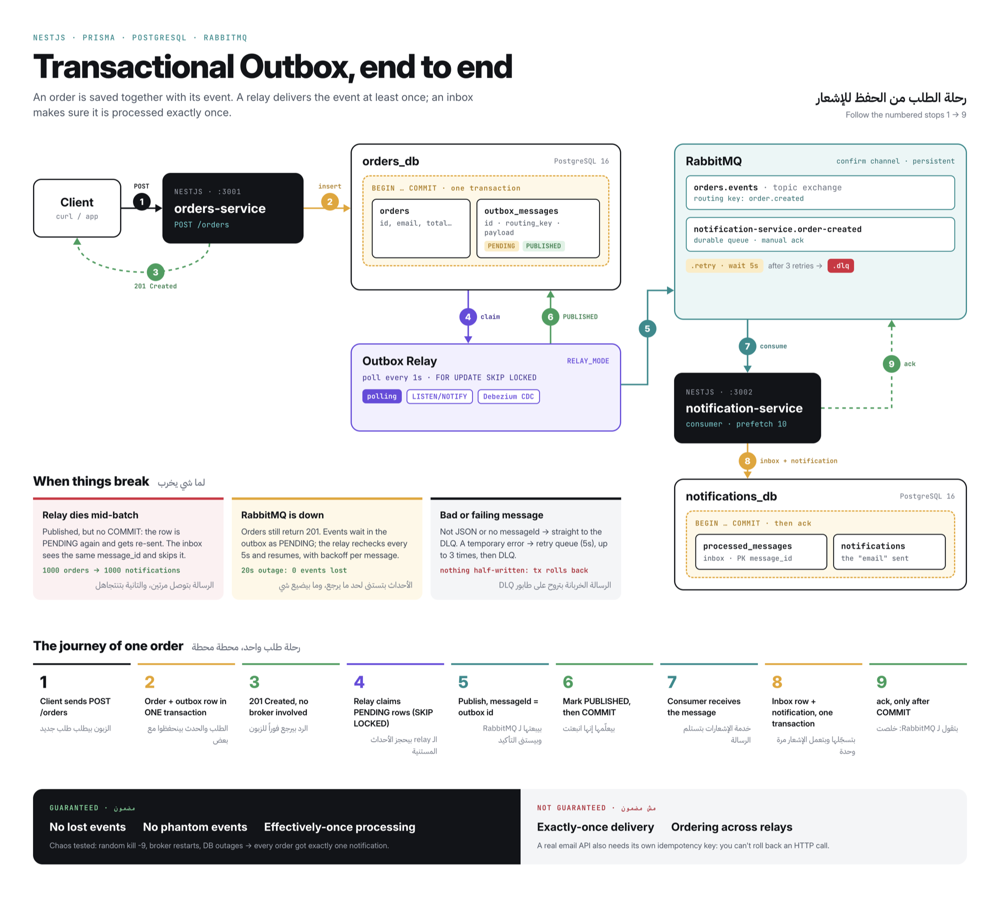
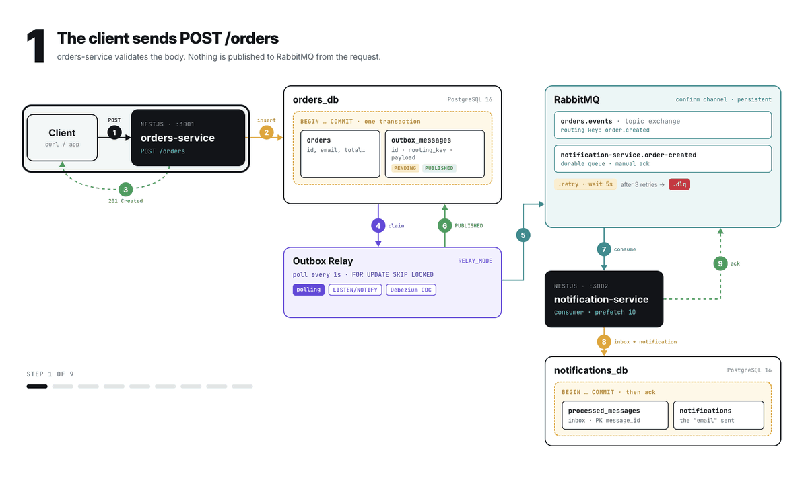

# Transactional Outbox, end to end

Save an order and **reliably** notify the customer: no lost events, no phantom events, no duplicate emails.
No distributed transactions. Built step by step, and tested by breaking it on purpose.

**NestJS · Prisma 7 · PostgreSQL 16 · RabbitMQ 3.13 · Docker**



### Request journey



## The problem

`orders-service` saves an order in Postgres and must tell `notification-service` through RabbitMQ.
That's two systems, with no transaction that covers both (a "dual write"):

- save, then publish → a crash in between leaves an order with **no event (lost)**;
- publish, then save → a failed save leaves an **event for an order that doesn't exist (phantom)**.

## The solution

1. **Outbox.** The order and an `outbox_messages` row are written in **one** database transaction. Both exist, or neither does.
2. **Relay.** A separate loop claims unsent rows (`FOR UPDATE SKIP LOCKED`), publishes them with publisher confirms,
   and marks them `PUBLISHED`. It retries with backoff. Delivery is **at-least-once**.
3. **Inbox.** The consumer records each `messageId` in `processed_messages` in the same transaction as the
   notification, and acks only after commit. Duplicates become no-ops.

## How a request flows

| # | Step |
|---|---|
| 1 | Client sends `POST /orders` to orders-service |
| 2 | `BEGIN` → insert into `orders` → insert into `outbox_messages` (`PENDING`) → `COMMIT` |
| 3 | `201 Created`. RabbitMQ is not on the request path |
| 4 | The relay claims `PENDING` rows with `SELECT … FOR UPDATE SKIP LOCKED` |
| 5 | Publishes to exchange `orders.events` (routing key `order.created`), `messageId` = outbox id, waits for the broker's confirm |
| 6 | Marks the row `PUBLISHED`, then `COMMIT` (a crash before this means a re-send later) |
| 7 | notification-service consumes from `notification-service.order-created` (manual ack) |
| 8 | `BEGIN` → insert into `processed_messages` (skip if already there) → insert into `notifications` → `COMMIT` |
| 9 | `ack`. Failures go to a retry queue (5s, 3 times), then to a dead-letter queue |

## Results from failure experiments

All measured on a laptop with the scripts in this repo:

| Experiment | Without the pattern | With outbox + inbox |
|---|---|---|
| Crash between save and publish (Stage 1 vs 2) | order saved, **event lost** | order + event committed together, event sent later |
| Publish first, then the save fails (Stage 1) | **phantom** notification | impossible: no commit, no event |
| `kill -9` the relay mid-batch, 1000 orders (Stage 3 vs 4) | **1222** notifications (222 duplicates) | **1000** notifications (209 re-deliveries skipped) |
| Chaos: 2000 orders, `kill -9` every 0.5s, RabbitMQ restart (Stage 5) | inbox off: **2423** notifications | inbox on: **2000** notifications |
| Relay latency, order → notification p50 (Stage 6) | polling (1s): **610ms** | Debezium CDC: **77ms** · LISTEN/NOTIFY: **15ms** |

## Guarantees

- ✅ No lost events: if the order exists, its event is eventually published
- ✅ No phantom events: an event exists only if its order committed
- ✅ Effectively-once processing: one notification per order, even with duplicate deliveries
- ✅ Survives crashes of any service, broker restarts and short database outages
- ❌ Exactly-once *delivery*: duplicates happen; the inbox absorbs them
- ❌ Global ordering across several relays
- ❌ Safe external side effects on its own: a real email API also needs an idempotency key

## Quick start

Requirements: **Node.js 20+** and **Docker**.

```bash
npm run infra:up                       # Postgres + RabbitMQ
npm install
cp apps/orders-service/.env.example apps/orders-service/.env
cp apps/notification-service/.env.example apps/notification-service/.env
npm run prisma:generate
npm run prisma:migrate

npm run dev:orders                     # terminal 1 → http://localhost:3001
npm run dev:notification               # terminal 2 → http://localhost:3002
```

```bash
curl http://localhost:3001/health
curl http://localhost:3002/health
```

RabbitMQ UI: http://localhost:15672 (user `outbox`, password `outbox`).

## Try it

```bash
# create an order
curl -X POST http://localhost:3001/orders -H 'content-type: application/json' \
  -d '{"customerEmail":"you@example.com","product":"Keyboard","quantity":1,"unitPriceCents":4999}'

curl http://localhost:3001/outbox?status=PUBLISHED       # the outbox
curl http://localhost:3002/notifications                 # what was "sent"
curl http://localhost:3002/notifications/stats           # inbox, duplicates skipped, queue depths

npm run trace -- <orderId>     # one order's journey across both databases
npm run chaos                  # failure experiment with a PASS/FAIL report (stop dev:orders first)
npm run latency                # compare relay modes (stop dev:orders first)
npm run relay                  # an extra standalone relay (needs a build: npm run build)
```

Relay modes (`RELAY_MODE` in `apps/orders-service/.env`):

| Mode | What happens |
|---|---|
| `polling` (default) | query the outbox every `RELAY_INTERVAL_MS` (1s) |
| `notify` | wake up on Postgres `NOTIFY` from a trigger, plus a 30s fallback poll |
| `none` | no relay; use this while Debezium publishes |

Debezium CDC (optional):

```bash
docker compose --profile cdc up -d debezium
RELAY_MODE=none npm run dev:orders
# when done: stop it and drop the replication slot (see docs/06-alternative-relays.md)
```

## Project structure

```
.
├── apps/
│   ├── orders-service/          # :3001, owns orders_db: orders, outbox, relay
│   └── notification-service/    # :3002, owns notifications_db: consumer, inbox
├── docker-compose.yml           # Postgres (wal_level=logical) + RabbitMQ [+ Debezium, profile cdc]
├── docker/
│   ├── postgres/init.sql        # creates notifications_db
│   └── debezium/conf/           # Debezium Server config
├── scripts/                     # chaos.mjs · trace.mjs · latency.mjs
└── docs/                        # one write-up per stage + diagram assets
```

Each service owns its database. They never read each other's tables; they only talk through RabbitMQ.

## Learning path

Each stage is a commit plus a write-up with experiments and real numbers:

| Stage | Doc | What it shows |
|---|---|---|
| 0 | [Setup](docs/00-setup.md) | Docker, two NestJS services, Prisma 7, one database per service |
| 1 | [The naive way](docs/01-naive-publish.md) | Save then publish, and the lost and phantom events that follow |
| 2 | [Outbox table](docs/02-outbox-table.md) | Order and event in one transaction; RabbitMQ off the request path |
| 3 | [Polling relay](docs/03-polling-relay.md) | `FOR UPDATE SKIP LOCKED`, confirms, backoff, at-least-once |
| 4 | [Idempotent consumer](docs/04-idempotent-consumer.md) | Inbox table, ack after commit, retry queue, DLQ |
| 5 | [Failure experiments](docs/05-failure-experiments.md) | Chaos script, invariants, a control run that fails |
| 6 | [Alternative relays](docs/06-alternative-relays.md) | LISTEN/NOTIFY and Debezium CDC, measured and compared |

## What I learned

1. **A dual write can't be made safe by ordering or retries.** One crash in between loses or invents an event.
2. **The outbox turns two systems into one transaction.** "Order exists" and "event must be sent" become atomic;
   sending becomes a separate, retryable job.
3. **`FOR UPDATE SKIP LOCKED` turns a table into a work queue.** Several relays split the work without double-publishing.
4. **The outbox is at-least-once, never exactly-once.** One `kill -9` mid-batch produced 222 duplicates.
5. **So the consumer must be idempotent.** An inbox row in the same transaction as the side effect, plus
   ack-after-commit, made those duplicates harmless.
6. **Failures need a path, not a log line.** Poison messages go to the DLQ; transient errors get delayed retries.
7. **Test the invariant under chaos, and prove the test can fail.** With the inbox off, the same check caught 423 duplicates.
8. **The relay is swappable; the guarantees aren't.** NOTIFY and CDC cut latency a lot, but delivery stays at-least-once.

## References

- [Pattern: Transactional outbox (microservices.io)](https://microservices.io/patterns/data/transactional-outbox.html)
- [Implementing the Outbox Pattern with NestJS, RabbitMQ and Postgres (Medium)](https://medium.com/@sebastian.iwanczyszyn/implementing-the-outbox-pattern-in-distributed-systems-with-nestjs-rabbitmq-and-postgres-65fcdb593f9b),
  reviewed in [docs/06](docs/06-alternative-relays.md#review-the-medium-articles-implementation-and-what-we-did-differently)
